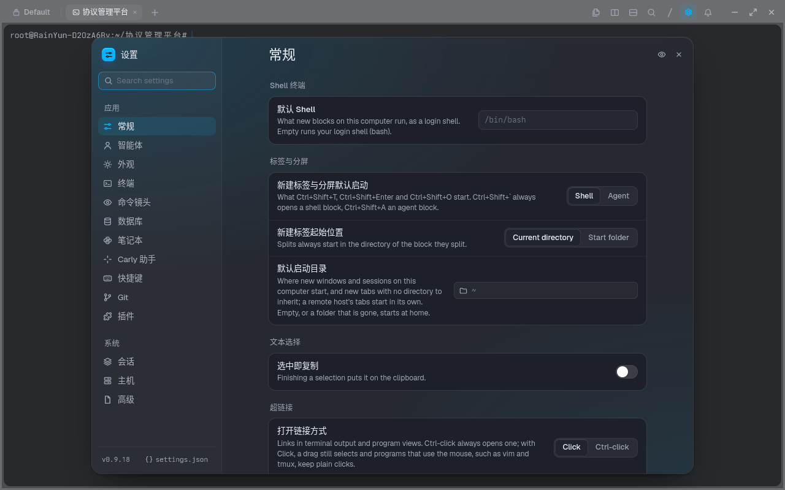

# Tern Chinese Plugin (`zh-cn`)

[Tern](https://stencil.so/tern) 简体中文汉化插件 — **直接汉化原生设置弹窗、命令面板与标签栏**，并内置覆盖 **322 项设置的交互式中文设置中心**、**中文快捷键管理**与 **223 项中文全功能菜单**。

A Simplified Chinese (`zh-CN`) localization plugin for [Tern](https://stencil.so/tern) that translates the native Settings dialog (all 14 pages), Command Palette scope tabs, and tab-bar buttons via CSS, alongside an interactive 322-setting Chinese Settings Center, Keybind Manager, and 223-action Chinese Command Menu.



---

## 核心特性 / Features

1. **原生设置弹窗直接汉化（v0.2.0 新增）**
   - 汉化左侧导航栏全部 14 个分类（常规、智能体、外观、终端、命令镜头、数据库、笔记本、Carly 助手、快捷键、Git、插件、会话、主机、高级）。
   - 汉化右侧全部 14 个设置页标题、分组标题及跨平台设置项名称。
   - **安全防错位设计**：搜索设置时自动退出分类作用域，Plugins 页仅锚定固定行，保留已安装插件名与远程主机名不被覆盖。
2. **命令面板 & 标签栏汉化**
   - 汉化命令面板全部 6 个作用域页签（`全部 / 命令 / 文件 / 搜索 / 会话 / 主机`）与标签栏按钮文字（`新建标签页`、`文件`）。
   - 原生命令面板直接注册 **44 个高频中文直达命令** + 5 个中文插件管理命令，直接输入中文即可触发操作。
3. **独立中文设置中心 & 快捷键管理（322 项配置 + 223 项功能）**
   - 在命令面板搜索 **`中文设置中心`** 或 **`中文菜单：全部功能…`** 即可打开带完整中文说明的独立交互面板：
     - 支持中英文关键词检索、仅看已修改项、一键恢复默认值；
     - 所有开关/枚举/主题/数值/JSON 修改均实时写入 `settings.json`；
     - 如习惯使用独立中文设置中心替代原生设置，可在面板顶栏开启 **「接管 Ctrl+,」**。

---

## 安装与更新 / Installation

在本地安装了 Tern 的终端中运行（或直接在 `Settings › Plugins › Install…` 填入 `github.com/maosasagawa/tern-chinese-plugin`）：

```bash
# 安装
tern plugin install github.com/maosasagawa/tern-chinese-plugin
tern plugin reload

# 从旧版本更新到最新
tern plugin install github.com/maosasagawa/tern-chinese-plugin --force
tern plugin reload
```

卸载：

```bash
tern plugin remove zh-cn
```

## License

[MIT](./LICENSE)
